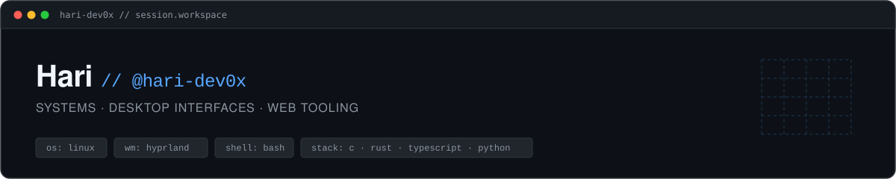

  

<h1 align="center">
  Hey there, I'm Hari
</h1>

  

---

<h2 align="center">👨‍💻 About Me</h2>

  Developer building software across desktop interfaces, system tooling, and web applications.

- 🖥️ **Desktop &amp; Systems:** Designing tailored Linux desktop workflows, Wayland compositors, and custom boot transitions.
- ⚡ **Low-Level Tooling:** Deepening practical experience in C, C++, and Rust for native performance and systems software.
- 🌐 **Modern Web:** Creating responsive, local-first web applications using TypeScript, React, and Next.js.
- 📱 **Mobile Exploration:** Developing native Android utilities with Kotlin and the Android SDK.

---

<h2 align="center">💻 Tech Stack</h2>

  <strong>Core Languages &amp; Ecosystem</strong> 
  

  <strong>Exploring &amp; Foundational</strong> 
  

---

<h2 align="center">🚀 Featured Projects</h2>

<table align="center" width="100%">
<tr>

<td width="50%" valign="top">
  <h4><a href="https://github.com/HarinarayananBS/Nexis-Browser">🌐 Nexis Browser</a></h4>
  
Privacy-focused desktop browser built with Electron &amp; React. Features native credential management and Ghostery content blocking.

  
<code>TypeScript</code> <code>Electron</code> <code>React</code> <code>Bun</code>

  
Active Development &nbsp;·&nbsp; <a href="https://harinarayananbs.github.io/Nexis-Browser/">Docs &amp; Preview</a>

</td>

<td width="50%" valign="top">
  <h4>⚙️ NexOS &amp; NexBoot</h4>
  
Personal Linux environment featuring custom Plymouth boot transitions, SDDM theme tooling, and Hyprland desktop workflows.

  
<code>Bash</code> <code>Python</code> <code>Linux</code> <code>Hyprland</code>

  
Experimental &nbsp;·&nbsp; Personal Development

</td>

</tr>
<tr>

<td width="50%" valign="top">
  <h4><a href="https://github.com/HarinarayananBS/Portfolio">💼 Portfolio Platform</a></h4>
  
Full-stack web architecture with draft workflows, WebP image processing pipelines, and secure authentication.

  
<code>TypeScript</code> <code>Next.js</code> <code>Prisma</code> <code>PostgreSQL</code>

  
Active Development

</td>

<td width="50%" valign="top">
  <h4>📱 NSS Report App</h4>
  
Native Android application built for structured report compilation and local-first data persistence.

  
<code>Kotlin</code> <code>Android SDK</code> <code>Gradle</code>

  
In Development (Local)

</td>

</tr>
</table>

---

<h2 align="center">📈 GitHub Activity</h2>

  

  

  <picture>
    <source media="(prefers-color-scheme: dark)" srcset="https://raw.githubusercontent.com/hari-dev0x/hari-dev0x/output/github-contribution-grid-snake-dark.svg">
    <source media="(prefers-color-scheme: light)" srcset="https://raw.githubusercontent.com/hari-dev0x/hari-dev0x/output/github-contribution-grid-snake.svg">
    
  </picture>

---

<h2 align="center">🌐 Let's Connect</h2>

  
  &nbsp;
  

  Building calm, functional software from the terminal to the desktop.

